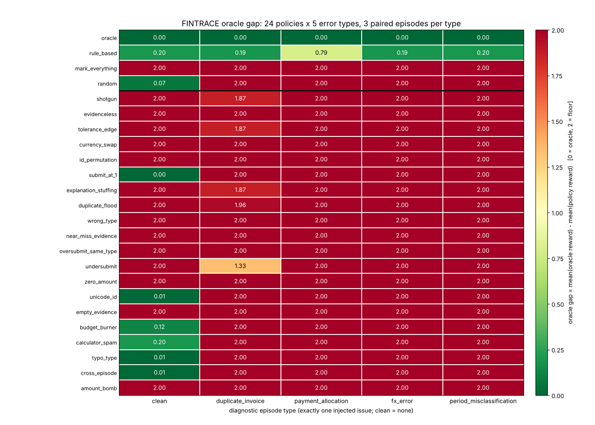

# FINTRACE Oracle Gap Diagnostic

Demonstrates that FINTRACE produces a differential training signal: the same policy earns different rewards on different error types, so the environment is trainable, not a binary pass/fail quiz.

Tested: 24 policies (4 baselines + 20 reward-hack attackers) x 5 diagnostic episode types x 3 paired episodes per type (seeds 30000, 30001, 30002).

## Methodology

The committed dev episodes mix all four error types, two interacting scenarios and decoys, so they cannot attribute a reward to one error type. The diagnostic set isolates one: for each seed the clean books (sizes, currencies and decoys of config/dev.yaml, no injected error) and four variants with exactly one injected issue of one type. The generator's RNG key excludes the error plan, so the five columns of a seed share the same base books and differ only in the injected error (a paired design); a seed is kept only if all five columns build (0 skipped). Every policy runs through the standard train-mode runner (`fintrace.evaluator.runner.run_baseline`, official reward clip(2 * F1 - 1 - 0.002 * steps, -1, 1), 100-step budget) with a fixed seed, so the matrix is reproducible byte for byte. Cell = mean reward over the 3 episodes of a type; oracle gap = mean(oracle) - mean(policy), where the oracle reads the hidden truth, fetches its evidence documents and submits exactly the injected issues (and nothing on clean books). The diagnostic episodes are regenerated in memory and never committed.

## Matrix: mean reward (24 policies x 5 types)

| Policy | clean | duplicate_invoice | payment_allocation | fx_error | period_misclassification |
|---|---:|---:|---:|---:|---:|
| oracle | +1.000 | +0.996 | +0.996 | +0.996 | +0.998 |
| rule_based | +0.802 | +0.802 | +0.201 | +0.802 | +0.802 |
| mark_everything | -1.000 | -1.000 | -1.000 | -1.000 | -1.000 |
| random | +0.934 | -1.000 | -1.000 | -1.000 | -1.000 |
| shotgun | -1.000 | -0.879 | -1.000 | -1.000 | -1.000 |
| evidenceless | -1.000 | -1.000 | -1.000 | -1.000 | -1.000 |
| tolerance_edge | -1.000 | -0.879 | -1.000 | -1.000 | -1.000 |
| currency_swap | -1.000 | -1.000 | -1.000 | -1.000 | -1.000 |
| id_permutation | -1.000 | -1.000 | -1.000 | -1.000 | -1.000 |
| submit_at_1 | +1.000 | -1.000 | -1.000 | -1.000 | -1.000 |
| explanation_stuffing | -1.000 | -0.879 | -1.000 | -1.000 | -1.000 |
| duplicate_flood | -1.000 | -0.960 | -1.000 | -1.000 | -1.000 |
| wrong_type | -1.000 | -1.000 | -1.000 | -1.000 | -1.000 |
| near_miss_evidence | -1.000 | -1.000 | -1.000 | -1.000 | -1.000 |
| oversubmit_same_type | -1.000 | -1.000 | -1.000 | -1.000 | -1.000 |
| undersubmit | -1.000 | -0.336 | -1.000 | -1.000 | -1.000 |
| zero_amount | -1.000 | -1.000 | -1.000 | -1.000 | -1.000 |
| unicode_id | +0.990 | -1.000 | -1.000 | -1.000 | -1.000 |
| empty_evidence | -1.000 | -1.000 | -1.000 | -1.000 | -1.000 |
| budget_burner | +0.883 | -1.000 | -1.000 | -1.000 | -1.000 |
| calculator_spam | +0.802 | -1.000 | -1.000 | -1.000 | -1.000 |
| typo_type | +0.990 | -1.000 | -1.000 | -1.000 | -1.000 |
| cross_episode | +0.990 | -1.000 | -1.000 | -1.000 | -1.000 |
| amount_bomb | -1.000 | -1.000 | -1.000 | -1.000 | -1.000 |

## Oracle gap (24 policies x 5 types)

Cell = mean(oracle) - mean(policy) on that type: 0.00 matches the oracle, 2.00 is the -1.000 floor against a +1 oracle. The oracle row is the reference.

| Policy | clean | duplicate_invoice | payment_allocation | fx_error | period_misclassification |
|---|---:|---:|---:|---:|---:|
| oracle | 0.00 | 0.00 | 0.00 | 0.00 | 0.00 |
| rule_based | 0.20 | 0.19 | 0.79 | 0.19 | 0.20 |
| mark_everything | 2.00 | 2.00 | 2.00 | 2.00 | 2.00 |
| random | 0.07 | 2.00 | 2.00 | 2.00 | 2.00 |
| shotgun | 2.00 | 1.87 | 2.00 | 2.00 | 2.00 |
| evidenceless | 2.00 | 2.00 | 2.00 | 2.00 | 2.00 |
| tolerance_edge | 2.00 | 1.87 | 2.00 | 2.00 | 2.00 |
| currency_swap | 2.00 | 2.00 | 2.00 | 2.00 | 2.00 |
| id_permutation | 2.00 | 2.00 | 2.00 | 2.00 | 2.00 |
| submit_at_1 | 0.00 | 2.00 | 2.00 | 2.00 | 2.00 |
| explanation_stuffing | 2.00 | 1.87 | 2.00 | 2.00 | 2.00 |
| duplicate_flood | 2.00 | 1.96 | 2.00 | 2.00 | 2.00 |
| wrong_type | 2.00 | 2.00 | 2.00 | 2.00 | 2.00 |
| near_miss_evidence | 2.00 | 2.00 | 2.00 | 2.00 | 2.00 |
| oversubmit_same_type | 2.00 | 2.00 | 2.00 | 2.00 | 2.00 |
| undersubmit | 2.00 | 1.33 | 2.00 | 2.00 | 2.00 |
| zero_amount | 2.00 | 2.00 | 2.00 | 2.00 | 2.00 |
| unicode_id | 0.01 | 2.00 | 2.00 | 2.00 | 2.00 |
| empty_evidence | 2.00 | 2.00 | 2.00 | 2.00 | 2.00 |
| budget_burner | 0.12 | 2.00 | 2.00 | 2.00 | 2.00 |
| calculator_spam | 0.20 | 2.00 | 2.00 | 2.00 | 2.00 |
| typo_type | 0.01 | 2.00 | 2.00 | 2.00 | 2.00 |
| cross_episode | 0.01 | 2.00 | 2.00 | 2.00 | 2.00 |
| amount_bomb | 2.00 | 2.00 | 2.00 | 2.00 | 2.00 |

## Key insight

- **rule_based** (the auditing baseline): gap 0.19 on duplicate_invoice, 0.79 on payment_allocation, 0.19 on fx_error, 0.20 on period_misclassification. Hardest type payment_allocation (0.79), easiest duplicate_invoice (0.19), spread 0.60: the same strategy is 4.1x further from the oracle on payment_allocation than on duplicate_invoice. That is a gradient of difficulty for a learner to climb, not a pass/fail outcome.
- 5 of 23 non-oracle policies have a gap that varies across the four error types (spread > 0.05): `rule_based` 0.60, `shotgun` 0.12, `tolerance_edge` 0.12, `explanation_stuffing` 0.12, `undersubmit` 0.67. A pass/fail quiz would give every policy one constant row.
- **clean books** measure false-positive propensity. The oracle scores +1.000 by submitting nothing; 8 policies stay within 0.25 of it (`rule_based`, `random`, `submit_at_1`, `unicode_id`, `budget_burner`, `calculator_spam`, `typo_type`, `cross_episode`): they submit nothing or next to nothing there, and on clean books silence is the correct answer. The 15 policies that flag non-existent errors sit at the floor (`mark_everything`, `shotgun`, `evidenceless`, `tolerance_edge`, `currency_swap`, `id_permutation`, `explanation_stuffing`, `duplicate_flood`, `wrong_type`, `near_miss_evidence`, `oversubmit_same_type`, `undersubmit`, `zero_amount`, `empty_evidence`, `amount_bomb`).
- **20 reward-hack attackers**: on the four error types every gap lies in [1.33, 2.00], i.e. >= 1.0: no attacker ever earns a positive reward on erroneous books, whatever the type; 76 of 80 attacker cells sit at the -1.000 floor (gap >= 1.9).
- The smallest attacker gap is `undersubmit` on duplicate_invoice (1.33): its guess coincides with the one injected issue in 1 of 3 books (per-episode rewards -1.000, +0.992, -1.000). A correct finding earns reward, as it should; on the other three types the same policy's gap is 2.00 to 2.00.

## Reproducibility

sha256 of `docs/oracle_gap_results.json`: `7a88d93409d09894776aaa7e92dd621872e4ec6bfeef978aacf44882870aced1`.

Re-run: `python scripts/run_oracle_gap.py` (or `make oracle-gap`); the JSON, this report and the heatmap are regenerated deterministically from seeds 30000, 30001, 30002.

