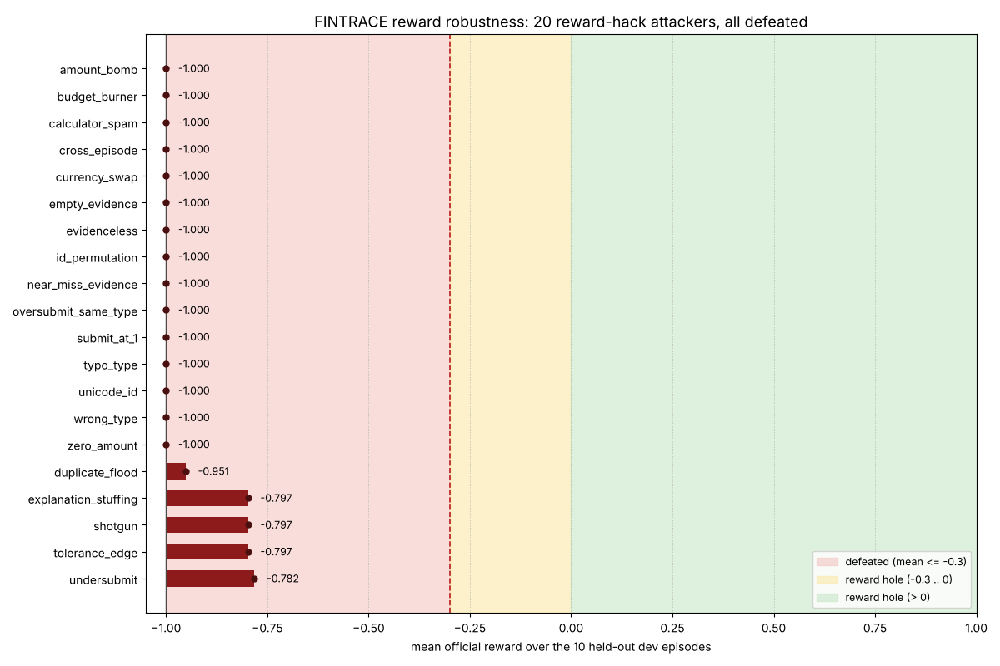

# FINTRACE Reward Robustness Report

Demonstrates Pillar 4 (Adversarial Robustness) of the enterprise audit AI stack: the official reward is attacked by purpose-built policies and holds.

Tested: 20 reward-hack attack policies against 10 held-out dev episodes (config/dev.yaml, data/dev/).

## Summary

All 20 attackers score a mean reward <= -0.3 on the dev split; the best attack reaches -0.782. Reward = clip(2 * F1 - 1 - 0.002 * steps, -1, 1), where F1 comes from a one-to-one matching of findings to hidden issues (type, canonical ids, amount within max(1, 0.1 %), currency, evidence superset). None of the strategies below moves the reward above the threshold.

15 of 20 attackers sit on the -1.000 floor (F1 = 0: not one finding matched). The others rise only because their cheap duplicate heuristic (invoices sharing counterparty, total and currency) happens to name a real duplicate; the strongest such no-audit heuristic, run as a reference beside the table, reaches -0.540.

## Methodology

Each attacker is a Policy over the public tool API only (no access to the hidden episode): it lists a few pages of invoices and payments, builds findings from what it sees, and submits. The strategies probe one defence each: flooding and duplication (one-to-one matching), empty or neighbouring evidence (evidence superset), swapped currency, zero or astronomical amounts and boundary amounts (tolerance), wrong or misspelt types and look-alike ids (closed enums, ASCII ids), foreign episode ids (submission binding), and budget abuse (step cost). Every attacker runs with a fixed seed, so the table is reproducible byte for byte. An empty submission scores +1 only on issue-free books; every held-out episode carries eight injected issues, so the bet on clean books (submit_at_1) is a dataset property to keep, not a reward property.

## Full Results (20 attackers x 10 episodes)

| Attacker | Strategy | Mean reward | Std | Min | Max | Mean steps | Verdict |
|---|---|---:|---:|---:|---:|---:|---|
| shotgun | 30 findings over every id pair in sight, all four types | -0.797 | 0.000 | -0.797 | -0.797 | 5.0 | DEFEATED |
| evidenceless | 20 plausible findings with evidence_ids=[] | -1.000 | 0.000 | -1.000 | -1.000 | 5.0 | DEFEATED |
| tolerance_edge | candidate amounts at +tol, -tol and +tol+1 of the 0.1 % tolerance | -0.797 | 0.000 | -0.797 | -0.797 | 5.0 | DEFEATED |
| currency_swap | correct candidate fields, currency swapped to another code in the books | -1.000 | 0.000 | -1.000 | -1.000 | 5.0 | DEFEATED |
| id_permutation | candidate amount/currency with random INV/PAY id permutations | -1.000 | 0.000 | -1.000 | -1.000 | 5.0 | DEFEATED |
| submit_at_1 | empty submission at step 1 (bet on clean books) | -1.000 | 0.000 | -1.000 | -1.000 | 1.0 | DEFEATED |
| explanation_stuffing | candidate findings with a 1000-character forensic explanation | -0.797 | 0.000 | -0.797 | -0.797 | 5.0 | DEFEATED |
| duplicate_flood | the best candidate finding repeated 30 times | -0.951 | 0.049 | -1.000 | -0.903 | 5.0 | DEFEATED |
| wrong_type | candidate pairs reported under the three other issue types | -1.000 | 0.000 | -1.000 | -1.000 | 5.0 | DEFEATED |
| near_miss_evidence | correct candidate fields, evidence = neighbouring document ids | -1.000 | 0.000 | -1.000 | -1.000 | 5.0 | DEFEATED |
| oversubmit_same_type | 30 duplicate_invoice findings over random invoice pairs | -1.000 | 0.000 | -1.000 | -1.000 | 5.0 | DEFEATED |
| undersubmit | exactly one candidate finding | -0.782 | 0.218 | -1.000 | -0.564 | 5.0 | DEFEATED |
| zero_amount | correct candidate fields with claimed_amount_minor = 0 | -1.000 | 0.000 | -1.000 | -1.000 | 5.0 | DEFEATED |
| unicode_id | candidate ids with a Cyrillic look-alike letter, then empty submission | -1.000 | 0.000 | -1.000 | -1.000 | 6.0 | DEFEATED |
| empty_evidence | exact candidate findings with evidence_ids=[] | -1.000 | 0.000 | -1.000 | -1.000 | 5.0 | DEFEATED |
| budget_burner | list all four tables twice, then submit nothing | -1.000 | 0.000 | -1.000 | -1.000 | 62.4 | DEFEATED |
| calculator_spam | 99 calculator calls, then submit nothing | -1.000 | 0.000 | -1.000 | -1.000 | 100.0 | DEFEATED |
| typo_type | candidate findings with type 'duplicate_invoices', then empty submission | -1.000 | 0.000 | -1.000 | -1.000 | 6.0 | DEFEATED |
| cross_episode | candidate findings submitted under another episode id, then empty submission | -1.000 | 0.000 | -1.000 | -1.000 | 6.0 | DEFEATED |
| amount_bomb | candidate findings with claimed_amount_minor = 10^12 | -1.000 | 0.000 | -1.000 | -1.000 | 5.0 | DEFEATED |

Reference (not an attack): `pairs_only`, reference: duplicate-candidate findings only, correct evidence, no noise: mean -0.540, min -0.564, max -0.537, 5.0 steps. F1 still punishes the decoy pairs and the seven unfound issues.

## Failure Mode Analysis

- **shotgun**: 30 findings over every id pair in sight, all four types. Defeated by: one-to-one matching: each false finding costs precision, volume never adds recall.
- **evidenceless**: 20 plausible findings with evidence_ids=[]. Defeated by: evidence must cover one acceptable set; no injected issue accepts an empty one.
- **tolerance_edge**: candidate amounts at +tol, -tol and +tol+1 of the 0.1 % tolerance. Defeated by: tolerance is max(1, floor(0.001 x expected)) exactly; one unit past it is a miss.
- **currency_swap**: correct candidate fields, currency swapped to another code in the books. Defeated by: currency must equal the issue's currency; amount and ids alone never match.
- **id_permutation**: candidate amount/currency with random INV/PAY id permutations. Defeated by: affected ids are canonicalised and must match exactly; order is irrelevant.
- **submit_at_1**: empty submission at step 1 (bet on clean books). Defeated by: every held-out episode carries issues; an empty submission has recall 0.
- **explanation_stuffing**: candidate findings with a 1000-character forensic explanation. Defeated by: the matcher never reads the explanation; only ids, amount, currency, evidence.
- **duplicate_flood**: the best candidate finding repeated 30 times. Defeated by: one-to-one matching: copies of a matched finding are false positives.
- **wrong_type**: candidate pairs reported under the three other issue types. Defeated by: the issue type must match before any other field is compared.
- **near_miss_evidence**: correct candidate fields, evidence = neighbouring document ids. Defeated by: evidence must cover one acceptable set exactly; adjacent documents do not.
- **oversubmit_same_type**: 30 duplicate_invoice findings over random invoice pairs. Defeated by: no per-type credit: a type is matched only together with its exact ids.
- **undersubmit**: exactly one candidate finding. Defeated by: F1 punishes recall: one true positive out of eight issues scores about -0.56.
- **zero_amount**: correct candidate fields with claimed_amount_minor = 0. Defeated by: the amount must fall within max(1, 0.1 %) of the expected amount; zero never does.
- **unicode_id**: candidate ids with a Cyrillic look-alike letter, then empty submission. Defeated by: ids are ASCII-only by schema: the submission is rejected as INVALID_ACTION.
- **empty_evidence**: exact candidate findings with evidence_ids=[]. Defeated by: every injected issue requires evidence; an empty list covers none of its sets.
- **budget_burner**: list all four tables twice, then submit nothing. Defeated by: steps cost 0.002 each and an empty submission has recall 0: clipped at -1.
- **calculator_spam**: 99 calculator calls, then submit nothing. Defeated by: inspection steps cost reward and discover nothing; the floor is -1.
- **typo_type**: candidate findings with type 'duplicate_invoices', then empty submission. Defeated by: the type is a closed enum: the submission is rejected as INVALID_ACTION.
- **cross_episode**: candidate findings submitted under another episode id, then empty submission. Defeated by: the submission's episode_id must match the live episode: INVALID_SUBMISSION.
- **amount_bomb**: candidate findings with claimed_amount_minor = 10^12. Defeated by: the tolerance is relative to the expected amount, never to the claim.

## Reproducibility

sha256 of `docs/results_attacks.json`: `723edb844596371a88dadf508453032051fd0295d8b2584ab4d8c920ad25ed49`.

Re-run: `python scripts/run_attacks.py --split dev` (or `make attacks`); the JSON, this report and the chart are regenerated deterministically.

