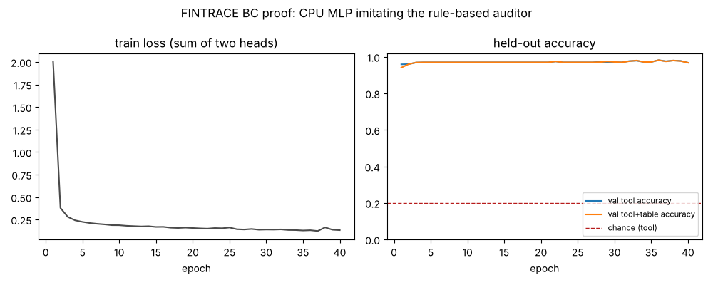

# BC proof: a CPU-trained MLP imitates the rule-based auditor

Status: **PASS** (thresholds: held-out tool accuracy >= 0.80, fine accuracy >= 0.75, both >= majority baseline + 0.15).

Claim: FINTRACE's public observations carry enough signal for a learner to predict the expert's next action far above chance, on an ordinary CPU, in seconds. This is the honest core of 'the environment is trainable'; there is no rollout (see Limits).

## Setup

- Expert: `rule_based` baseline, recorded with the standard runner.
- Train: 40 episodes / 3844 steps = the 10 committed train seeds + 30 extra train-config seeds from 2000 (skipped as infeasible: [2001, 2003, 2025, 2030, 2033]).
- Validation (held out): 10 committed dev episodes / 1000 steps.
- Features: 37 public-only prefix features (`featurize.py`, torch-free).
- Model: MLP 37 -> 64 -> 64 -> two heads (5 tools, 8 fine targets); Adam lr 0.001, batch 64, 40 epochs, seed 0 (torch.manual_seed + random.Random).
- Platform: 3.11.18, torch 2.15.0+cu132, 2 CPU thread(s), x86_64; wall time 8.8 s (recording 5.1 s, training 3.5 s).

## Result (held-out dev seeds)

| Target | Classes | Chance | Majority baseline | BC accuracy | Threshold |
|---|---:|---:|---:|---:|---:|
| tool | 5 | 0.200 | 0.511 | **0.968** | 0.80 |
| tool + table | 8 | 0.125 | 0.511 | **0.968** | 0.75 |

Per-class recall (tool head, held out):

| Tool | Share of expert steps | Recall |
|---|---:|---:|
| list_records | 0.307 | 1.000 |
| get_record | 0.172 | 0.942 |
| get_document | 0.511 | 0.965 |
| calculator | 0.000 | n/a |
| submit | 0.010 | 0.600 |

## Learning curve

| Epoch | Train loss | Train tool acc | Val tool acc | Val fine acc |
|---:|---:|---:|---:|---:|
| 1 | 2.003 | 0.958 | 0.959 | 0.941 |
| 2 | 0.380 | 0.959 | 0.960 | 0.960 |
| 5 | 0.225 | 0.969 | 0.970 | 0.970 |
| 10 | 0.188 | 0.969 | 0.970 | 0.970 |
| 20 | 0.157 | 0.970 | 0.970 | 0.970 |
| 30 | 0.140 | 0.966 | 0.971 | 0.972 |
| 40 | 0.134 | 0.974 | 0.968 | 0.968 |

## Limits (read before quoting)

- No rollout reward: the expert's `submit` carries findings (amounts, ids, evidence) produced by its reasoning, not an action label. Driving the environment would need hand-written argument selection and finding construction, and the reward would measure those heuristics rather than the learned policy. The claim here is action prediction only.
- The expert is deterministic and procedural, so its action sequence is highly learnable; the proof shows the observations expose that structure, not that a hard auditing problem is solved. The two progress features (`step_fraction`, `remaining_fraction`) let the model learn the expert's fixed budget schedule; `submit` has the lowest recall because its timing depends on the expert's finding construction, not on the public prefix alone.
- torch is not bit-reproducible across machines; the numbers above are from one seeded run and the thresholds are regression guards with margin, not pins.
- Trajectories are regenerated on every run and never committed; everything in this directory is outside the jury path, the main test suite and the Docker image.

Regenerate: `make bc-proof` (results in `bc_results.json`).
